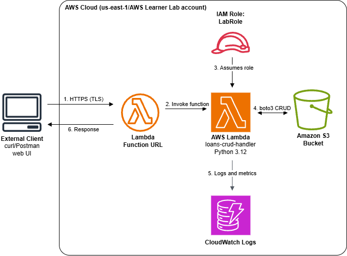

# Serverless Equipment Loan Management API (Track C)

A serverless CRUD REST API built on AWS (**API Gateway**, **Lambda**, and **DynamoDB**) for tracking laboratory and campus equipment loans.

## Architecture

